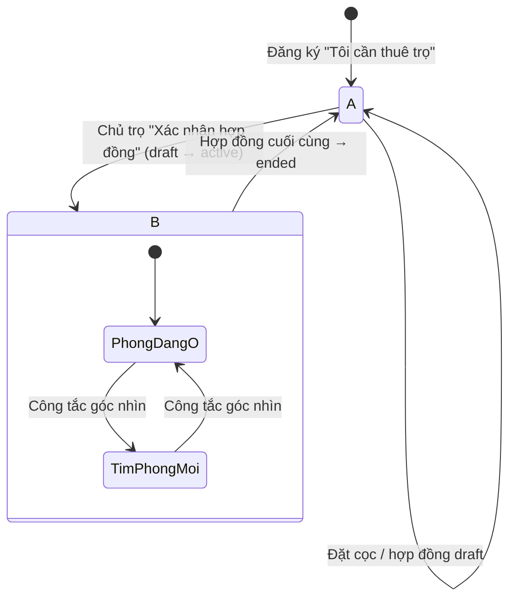

# Khu vực Người thuê: một tài khoản, hai giai đoạn

Một người dùng `renter` đi qua hai giai đoạn: **đang tìm phòng**, rồi **đang ở trọ**. Họ không tạo tài khoản mới, cũng không bị "chuyển vai trò". Khu vực `/tai-khoan/` tự đổi menu và trang chủ theo dữ liệu hợp đồng của họ, và vẫn cho họ quay lại tìm phòng khi cần.

Tài liệu này quy định: cách xác định trạng thái, menu cho từng trạng thái, công tắc góc nhìn, và trải nghiệm lúc chuyển từ A sang B.

---

## 1. Trạng thái (State) và Góc nhìn (View)

Hai khái niệm tách riêng, không được gộp:

| | Là gì | Ai quyết định | Lưu ở đâu |
|---|---|---|---|
| **State** | Sự thật về dữ liệu: người này có hợp đồng hiệu lực hay không | Hệ thống, suy ra từ `contracts` | Không lưu, luôn tính lại |
| **View** | Người dùng muốn ưu tiên nhóm tính năng nào lúc này | Người dùng (chỉ khi ở State B) | Cookie `ancu_view` (để Server Component render đúng menu ngay, không nháy) |

### Quy tắc phân định

```
activeContracts = contracts WHERE tenant_id = auth.uid() AND status = 'active'

State A "Đang tìm phòng"  ⇔  activeContracts.length = 0
State B "Đang ở trọ"      ⇔  activeContracts.length ≥ 1
```

- Chỉ `status = 'active'` mới tính. Hợp đồng `draft` (chủ trọ chưa xác nhận) vẫn là **State A**, nhưng có thẻ "Hợp đồng chờ xác nhận" (xem mục 4).
- Hợp đồng `active` có `start_date` ở tương lai vẫn là **State B**, kèm nhãn "Sắp chuyển vào · 01/11". Hoá đơn và báo chỉ số chưa mở cho tới ngày bắt đầu.
- Hợp đồng chuyển `ended` và không còn hợp đồng `active` nào khác → quay về **State A**. Hợp đồng cũ vẫn xem được ở "Hợp đồng đã kết thúc".
- Tính ở server: thêm `renterState` và `activeContracts` vào kết quả của `getCurrentProfile()`, để layout `(app)/tai-khoan/layout.tsx` render sidebar mà không cần gọi thêm từ client.

### Góc nhìn

| State | View có thể chọn | Mặc định |
|---|---|---|
| A | Chỉ `kham-pha`, không hiện công tắc | `kham-pha` |
| B | `phong-dang-o` hoặc `tim-phong-moi` | `phong-dang-o` |

Đổi view **không ẩn** nhóm nào. View chỉ đổi **thứ tự và độ nổi bật**, để người đang tìm phòng mới vẫn thấy ngay khi có hoá đơn quá hạn.



---

## 2. Sơ đồ menu theo trạng thái

### Bảng so sánh

| # | State A: Đang tìm phòng | State B · view "Phòng đang ở" (mặc định) | State B · view "Tìm phòng mới" |
|---|---|---|---|
| 0 | Không có công tắc | Công tắc: **[Phòng đang ở]** · Tìm phòng mới | Công tắc: Phòng đang ở · **[Tìm phòng mới]** |
| 1 | **Nhóm KHÁM PHÁ** (mở) | Thẻ phòng: *P.204 · Nhà trọ Hoa Sữa* (▾ nếu có nhiều hợp đồng) | **Nhóm KHÁM PHÁ** (mở) |
| 2 | Tìm phòng & bản đồ | **Nhóm PHÒNG ĐANG Ở** (mở) | Tìm phòng & bản đồ |
| 3 | Phòng đã lưu | Tổng quan phòng | Phòng đã lưu |
| 4 | Lịch xem phòng `badge` | Hoá đơn hàng tháng `badge đỏ/vàng` | Lịch xem phòng `badge` |
| 5 | **Nhóm THUÊ PHÒNG** (chỉ hiện khi có việc) | Báo chỉ số điện nước `chấm khi tới kỳ` | **Thẻ thu gọn "Phòng đang ở"**: P.204 + cảnh báo gấp nhất ("Hoá đơn T10 quá hạn 2 ngày") → bấm để về view kia |
| 6 | Đặt cọc & hợp đồng chờ ký `Chờ xác nhận` | Báo sự cố hỏng hóc `số sự cố đang mở` | |
| 7 | | Hợp đồng điện tử | |
| 8 | | **Nhóm KHÁM PHÁ** (thu gọn, 1 dòng "Tìm phòng mới ›") | |
| 9 | **CHUNG**: Tin nhắn, Hỗ trợ & báo cáo | **CHUNG**: Tin nhắn, Hỗ trợ & báo cáo | **CHUNG**: Tin nhắn, Hỗ trợ & báo cáo |

### Phác thảo sidebar

```
STATE A                         STATE B · Phòng đang ở           STATE B · Tìm phòng mới
┌──────────────────────────┐    ┌──────────────────────────┐    ┌──────────────────────────┐
│ A An Cư                  │    │ A An Cư                  │    │ A An Cư                  │
│ Khu vực · Người thuê     │    │ ┌──────────┬───────────┐ │    │ ┌──────────┬───────────┐ │
│                          │    │ │■Phòng đang ở│Tìm mới │ │    │ │Phòng đang ở│■Tìm mới│ │
│ KHÁM PHÁ                 │    │ └──────────┴───────────┘ │    │ └──────────┴───────────┘ │
│ ▸ Tìm phòng & bản đồ     │    │ ┌──────────────────────┐ │    │ KHÁM PHÁ                 │
│   Phòng đã lưu           │    │ │ P.204 · Hoa Sữa    ▾ │ │    │ ▸ Tìm phòng & bản đồ     │
│   Lịch xem phòng      2  │    │ │ Đang ở · đến 10/2027 │ │    │   Phòng đã lưu           │
│                          │    │ └──────────────────────┘ │    │   Lịch xem phòng      1  │
│ THUÊ PHÒNG               │    │ PHÒNG ĐANG Ở             │    │                          │
│   Đặt cọc & hợp đồng  ●  │    │ ▸ Tổng quan phòng        │    │ ┌──────────────────────┐ │
│                          │    │   Hoá đơn hàng tháng  1  │    │ │ P.204 · Hoa Sữa      │ │
│ ──────────────────────── │    │   Báo chỉ số điện nước ● │    │ │ ⚠ Hoá đơn T10 quá hạn│ │
│   Tin nhắn            3  │    │   Báo sự cố hỏng hóc     │    │ └──────────────────────┘ │
│   Hỗ trợ & báo cáo       │    │   Hợp đồng điện tử       │    │ ──────────────────────── │
└──────────────────────────┘    │                          │    │   Tin nhắn            3  │
                                │   Tìm phòng mới       ›  │    │   Hỗ trợ & báo cáo       │
                                │ ──────────────────────── │    └──────────────────────────┘
                                │   Tin nhắn            3  │
                                │   Hỗ trợ & báo cáo       │
                                └──────────────────────────┘
```

### Quy tắc chi tiết

- **Nhóm THUÊ PHÒNG ở State A** chỉ hiện khi người thuê có lịch xem `completed`, đơn cọc đang xử lý, hoặc hợp đồng `draft`. Người mới đăng ký chỉ thấy 3 mục Khám phá, đúng lúc họ cần.
- **Nhiều hợp đồng `active`** (ví dụ thuê cho mình và cho con): thẻ phòng đầu nhóm có ▾ để chọn phòng. Mọi trang trong nhóm lọc theo phòng đã chọn, lưu ở `?phong=<contract_id>`. Huy hiệu ở sidebar là tổng của mọi phòng.
- **Công tắc góc nhìn** là segmented control 2 nút (Radix `ToggleGroup`, `role="radiogroup"`), mỗi nút cao ≥ 44px. Đổi view sẽ ghi cookie, rồi điều hướng tới trang đầu của nhóm vừa chọn: `Tổng quan phòng` hoặc `Tìm phòng & bản đồ`.
- **Tự đổi view theo trang đang mở.** Mở trực tiếp `/tim-tro` hay `/tai-khoan/da-luu` khi đang ở view "Phòng đang ở" thì sidebar tự chuyển sang "Tìm phòng mới", để mục đang mở luôn nằm trong nhóm đang mở.
- **Di động (≤ 960px):** công tắc nằm đầu drawer, ngay dưới logo. Thanh trên cùng hiện tên view hiện tại ("Phòng đang ở ▾") để đổi nhanh mà không cần mở drawer.
- **Huy hiệu:** đỏ cho việc quá hạn (hoá đơn `overdue`), vàng cho việc tới hạn (hoá đơn `pending`, kỳ báo chỉ số đang mở), số trung tính cho đếm thông thường. Mỗi mục tối đa một huy hiệu.

### Route

| Nhóm | Mục | Route | Ghi chú |
|---|---|---|---|
| Khám phá | Tìm phòng & bản đồ | `/tim-tro` (công khai) | Prototype: `tai-khoan/tim-phong.html` |
| | Phòng đã lưu | `/tai-khoan/da-luu` | |
| | Lịch xem phòng | `/tai-khoan/lich-xem` | |
| Thuê phòng (A) | Đặt cọc & hợp đồng chờ ký | `/tai-khoan/thue-phong` | Tách phần "Phòng đã xem xong" + đặt cọc ra khỏi `thanh-toan-tien-nha.html` hiện nay |
| Phòng đang ở (B) | Tổng quan phòng | `/tai-khoan/phong-dang-o` | Trang mới, trang chủ của State B |
| | Hoá đơn hàng tháng | `/tai-khoan/hoa-don` | Phần hoá đơn của `thanh-toan-tien-nha.html` |
| | Báo chỉ số điện nước | `/tai-khoan/dien-nuoc` | Mới |
| | Báo sự cố hỏng hóc | `/tai-khoan/su-co` | Mới |
| | Hợp đồng điện tử | `/tai-khoan/hop-dong` | Đã có trong CLAUDE.md |
| Chung | Tin nhắn | `/tai-khoan/tin-nhan` | |

`/tai-khoan` (gốc) chuyển hướng theo state: A → `/tim-tro`, B → `/tai-khoan/phong-dang-o`.

Mở một route của State B khi đang ở State A (ví dụ link cũ trong email): **không** 404, cũng không chuyển hướng im lặng. Hiện trạng thái rỗng "Bạn chưa có phòng đang ở" kèm nút "Tìm phòng". Nếu có hợp đồng `draft`, thay bằng "Hợp đồng của bạn đang chờ chủ trọ xác nhận".

### Cần bổ sung dữ liệu (ngoài mô hình v1 hiện tại)

- **Báo sự cố:** bảng mới `maintenance_requests` gồm `contract_id`, `room_id`, `renter_id`, `landlord_id`, `category`, `description`, `images text[]`, `status` (`'open' | 'in_progress' | 'resolved'`), `resolved_at`. Phía chủ trọ thêm trang `/quan-ly/su-co`.
- **Người thuê báo chỉ số:** `meter_readings` thêm `submitted_by`, `photo_url`, `status` (`'submitted' | 'confirmed'`). Chủ trọ xác nhận chỉ số rồi mới xuất hoá đơn.

Hai mục này cần migration riêng, chạy `npm run db:types` sau đó (theo quy trình trong CLAUDE.md).

---

## 3. Trang "Tổng quan phòng" (trang chủ State B)

Từ trên xuống, mỗi section có scroll reveal:

1. **Việc cần làm**: tối đa 3 thẻ, xếp theo độ gấp, ví dụ "Hoá đơn T10 · 3.450.000₫ · hạn 05/11 → Thanh toán", "Kỳ báo chỉ số T11 đã mở → Báo chỉ số", "Sự cố 'Vòi nước rò' · chủ trọ đang xử lý". Không có việc gì thì hiện "Mọi thứ đều ổn".
2. **Phòng của bạn**: ảnh 4:3, tên phòng, địa chỉ, giá thuê, thời hạn hợp đồng (thanh tiến độ "còn 8 tháng").
3. **Chủ trọ**: tên, nút Gọi / Nhắn tin.
4. **Lịch tháng này**: ngày báo chỉ số, ngày xuất hoá đơn, hạn thanh toán.

---

## 4. Chuyển từ State A sang State B

### Bối cảnh trước khi chuyển

Người thuê đã xem phòng (lịch `completed`), bấm "Thuê phòng này", đặt cọc xong. Chủ trọ tạo hợp đồng `draft`. Lúc này người thuê vẫn ở **State A**, mục "Đặt cọc & hợp đồng chờ ký" có huy hiệu vàng "Chờ xác nhận", và trang đó hiện thẻ:

> **Hợp đồng phòng P.204 đang chờ chủ trọ xác nhận**
> Bắt đầu 01/11/2026 · 3.000.000₫/tháng · Cọc 3.000.000₫
> [Xem bản hợp đồng] · [Nhắn chủ trọ]

### Bước 1: Chủ trọ bấm "Xác nhận hợp đồng"

Server Action `confirmContract(contractId)` trong `app/(app)/quan-ly/hop-dong/actions.ts`:

1. Kiểm tra `role = 'landlord'` và `contracts.landlord_id = auth.uid()`, hợp đồng đang `draft`.
2. Trong một giao dịch:
   - `contracts.status` → `'active'`.
   - `rooms.status` → `'rented'`, `is_published` → `false`.
   - Ghi `notifications` cho người thuê: `type = 'contract_activated'`, `payload = { contract_id, room_title, start_date }`.
3. `revalidatePath('/tai-khoan', 'layout')` và `revalidatePath('/quan-ly/hop-dong')`.

Lịch xem phòng khác của người thuê **không tự huỷ**. Hệ thống hỏi người thuê ở bước 4.

### Bước 2: Người thuê nhận tin (đang mở ứng dụng)

- Client component trong layout `tai-khoan` subscribe Supabase Realtime vào `notifications` của chính user.
- Khi nhận `contract_activated`: hiện **toast** "Hợp đồng phòng P.204 đã có hiệu lực 🎉" kèm nút **[Xem phòng của bạn]**.
- **Không xếp lại sidebar ngay dưới tay người dùng.** Họ có thể đang điền form đặt lịch hay đang nhắn tin. Đầu sidebar chỉ hiện một dải mời: "Bạn đã có phòng · Mở khu Phòng đang ở". Bố cục mới áp dụng khi họ bấm toast, bấm dải mời, hoặc điều hướng sang trang khác (layout đã revalidate).
- Nếu không mở ứng dụng: thông báo nằm trong chuông. Lần đăng nhập sau họ vào thẳng State B.

### Bước 3: Lần đầu vào State B

- Cookie `ancu_view` được đặt `phong-dang-o`, và người dùng vào `/tai-khoan/phong-dang-o`.
- Nhóm **Phòng đang ở** xuất hiện ở đầu sidebar: fade + slide-down 16px, 300ms, các mục con stagger 40ms. Nhóm Khám phá thu lại thành một dòng "Tìm phòng mới ›". Không animation khi bật `prefers-reduced-motion`.
- Trang Tổng quan mở bằng **khối chào mừng chỉ hiện một lần** (đánh dấu đã xem bằng `notifications.read_at`):

> **Chào mừng về nhà, Trang!**
> Từ giờ bạn theo dõi hoá đơn, báo điện nước và báo sự cố cho P.204 ngay tại đây.
>
> ☐ Xem lại hợp đồng điện tử
> ☐ Chụp chỉ số điện nước ngày nhận phòng *(làm chỉ số đầu kỳ cho hoá đơn đầu tiên)*
> ☐ Lưu liên hệ chủ trọ
>
> Hoá đơn đầu tiên: dự kiến 05/12/2026

- Checklist chỉ là gợi ý, không chặn thao tác nào. Bấm từng mục sẽ dẫn tới trang tương ứng. Hoàn thành hết hoặc bấm "Ẩn" thì khối này biến mất.

### Bước 4: Dọn dữ liệu giai đoạn tìm phòng

Ngay dưới khối chào mừng, chỉ hiện khi còn dữ liệu cần dọn:

> Bạn còn **2 lịch xem phòng** sắp tới ở nơi khác.
> [Huỷ tất cả và báo chủ trọ] · [Giữ lại]

- "Huỷ tất cả" sẽ chuyển các `viewing_appointments` `requested`/`confirmed` của người thuê sang `cancelled`, kèm lý do "Người thuê đã tìm được phòng", và thông báo cho từng chủ trọ.
- "Phòng đã lưu" giữ nguyên, không hỏi.

### Bước 5: Về sau

- Người thuê muốn tìm phòng mới (sắp hết hạn, muốn chuyển chỗ): bấm công tắc "Tìm phòng mới". Toàn bộ Khám phá hoạt động như State A, còn thẻ thu gọn "Phòng đang ở" vẫn báo việc gấp.
- Khi hợp đồng còn ≤ 30 ngày: thẻ "Việc cần làm" thêm "Hợp đồng hết hạn 31/10/2027 · Gia hạn hay tìm phòng mới?", với nút [Nhắn chủ trọ gia hạn] · [Tìm phòng mới] (bấm vào là đổi view).
- Hợp đồng cuối cùng chuyển `ended` sẽ quay về State A: xoá cookie view, nhóm Phòng đang ở biến mất, mở `/tim-tro` với banner một lần "Hợp đồng P.204 đã kết thúc · Xem lại hợp đồng và hoá đơn cũ".

---

## 5. Áp dụng vào prototype HTML hiện tại

- `components/sidebar.js`: đổi `SIDEBAR_MENU` từ mảng phẳng sang mảng nhóm `{ key, label, states: ['A'|'B'], items: [...] }`. Thêm `AnCuSidebar.setState('A'|'B')`. View lưu ở `localStorage['an-cu-view']`. Thêm `<an-cu-view-switch>` render công tắc khi state là B.
- State lấy từ máy chủ prototype: thêm `GET /api/hop-dong?nguoi=` trong `server/index.mjs`. Khi không có máy chủ, dùng giá trị mẫu: `u-trang` là B (khớp hoá đơn mẫu ở `thanh-toan-tien-nha.html`), các người thuê mẫu khác là A.
- Tách `tai-khoan/thanh-toan-tien-nha.html` thành `hoa-don.html` (B) và `thue-phong.html` (A). `dat-coc.html` giữ nguyên trong luồng A.
